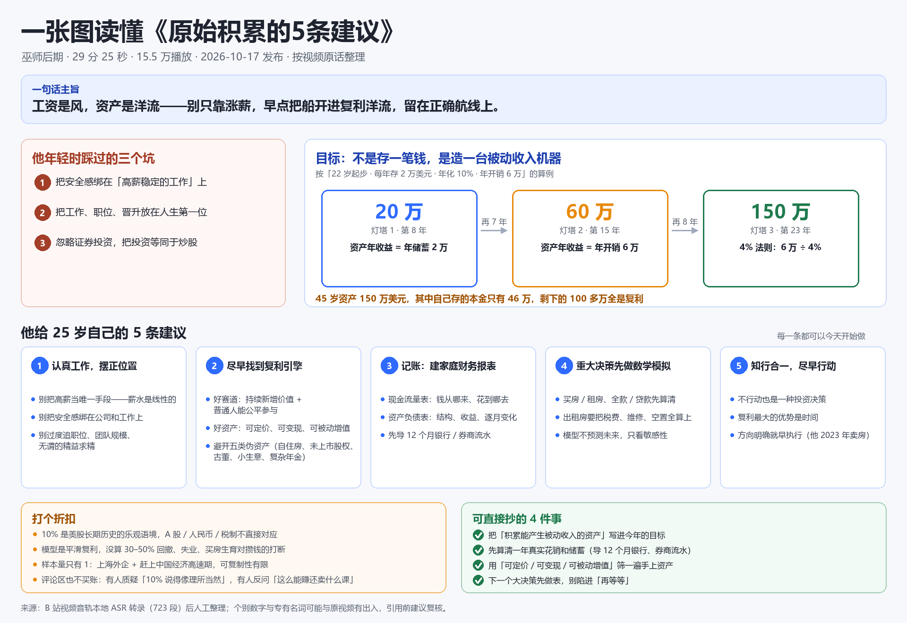
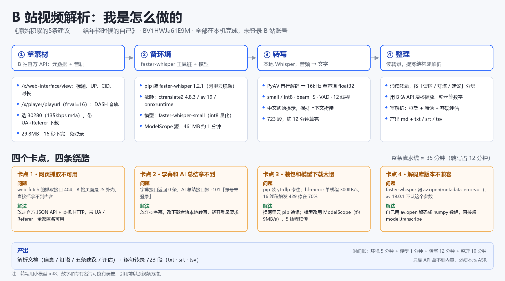
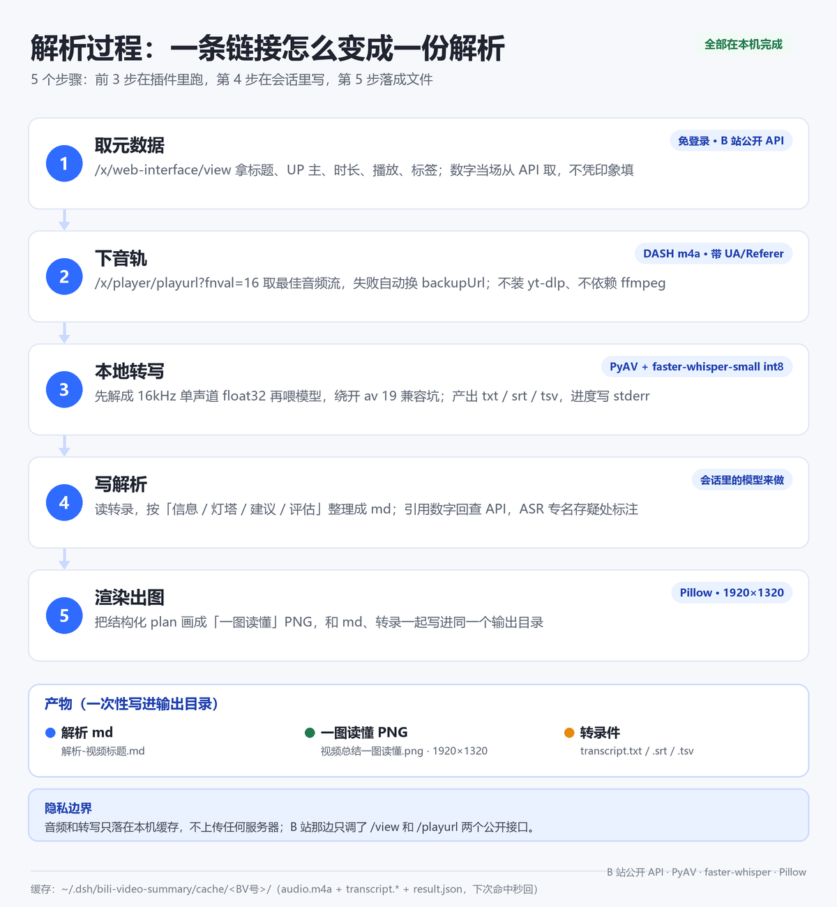

<p align="center">
  
</p>

<div align="center">

[](https://github.com/deepseek-ai/deepseek-harness)
[]()
[]()
[]()
[](./LICENSE)

</div>

---

## 1. 它是什么

一个跑在 DSH 里的小插件：你在会话里丢一个 B 站视频链接，它把视频的语音转成文字，模型读完后写一份解析，再画一张 1920×1320 的「一图读懂」。

用一句话说清楚它替你省了什么：

- 30 分钟的视频，先看一张 1920×1320 的图，感兴趣再翻解析里的原话。
- 请求只走 B 站公开 JSON 接口（`view` / `playurl`），带 UA 和 Referer，不碰 cookies。
- 官方字幕接口匿名请求返回 0 条，所以插件直接下音轨做本地 ASR。
- 下载、解码、转写都在你电脑上完成，音频只在本机缓存留一份。
- 同一个视频第二次问会直接读缓存，不重复下载和转写。

## 2. 效果预览

| 一图读懂（插件渲染） | 解析复盘图（同一条视频的手工流程记录） |
|---|---|
|  |  |

示例视频：《原始积累的 5 条建议》（BV1HWJa61E9M，29 分 25 秒）。

左图是插件直接产出的成品，右边那张是第一次手工解析时留下的流程复盘，插件已经把这张图里的步骤固化下来了。数字和专名以原视频为准——ASR 对低频词和数字会有误差，解析里会标注。

## 3. 解析过程



具体每一步做了什么：

1. **取元数据**：解析 BV 号，调 `/x/web-interface/view` 拿标题、UP 主、时长、播放、点赞、标签。数字全部当场从接口取，不凭印象填。
2. **下音轨**：调 `/x/player/playurl?fnval=16` 取 DASH 音轨（m4a），优先挑码率最高的一路，失败自动换 backupUrl。不装 yt-dlp，也不依赖 ffmpeg。
3. **本地转写**：用 PyAV 把音轨解成 16kHz 单声道 float32，再喂 `faster-whisper-small`（int8，CPU）。输出 `txt` / `srt` / `tsv`，进度写 stderr，结果用一行 `RESULT_JSON:` 回传给 DSH。
4. **写解析**：这一步在会话里由模型完成，不是插件算的。模型读完整转录，按「信息 / 灯塔 / 建议 / 评估」组织成 md；引用到的数字回接口核对，ASR 专名存疑的地方直接标注。
5. **渲染出图**：把结构化内容交给 Pillow 画成「一图读懂」，同时把 md 和转录文件一起写进输出目录。

一次性产出：

| 产物 | 说明 |
|---|---|
| `解析-视频标题.md` | 通读用的解析文档，含框架、原话和评估 |
| `视频总结一图读懂.png` | 1920×1320，一页看完 |
| `transcript.txt` / `.srt` / `.tsv` | 逐句转录，方便回查原话 |

耗时参考（CPU 推理，具体看机器）：

| 环节 | 首次 | 同一个视频第二次 |
|---|---|---|
| 取元数据 + 下音轨 | 十几秒（10 分钟视频音轨约 20–30MB） | 命中缓存，0 |
| 本地转写 | 约视频时长 × 0.4（30 分钟约 12 分钟） | 命中缓存，0 |
| 写解析 + 渲染 | 取决于模型和内容长度，一般几十秒到几分钟 | 同左（解析要重写） |

## 4. 快速开始

### 4.1 前置条件

- **Windows 10 / 11**：一键装环境脚本是 PowerShell 写的；插件逻辑本身跨平台，但脚本目前只覆盖 Windows。
- **DSH 桌面版**：已实测 **0.2.1-rc.2**，需要支持 `ctx.tools` 工具注册的版本。
- **磁盘约 725MB**：模型 462MB + Python 依赖约 260MB，首次装环境要联网。
- 不需要 B 站账号，不需要 ffmpeg，不需要 yt-dlp。

### 4.2 安装插件

命令行走 profile 的插件管理器安装（DSH 桌面版一般用 `desktop`，dsh web 用 `web`）：

```bash
dsh plugin --profile desktop add github:zz12hui/dsh-bili-video-summary
```

> DSH 桌面版正在运行时，命令行不会改应用的 profile：先退出桌面版再执行，或等上架后在市场里一键安装。

装完**重启 DSH**（关闭窗口含托盘退出 → 重开 → 恢复会话）。首次使用还要装一次运行环境（模型 + Python 依赖，约 725MB），脚本位置见下面手动安装的第 3 条。

<details>
<summary>手动安装（旧版 / 离线环境）</summary>

```bash
git clone https://github.com/zz12hui/dsh-bili-video-summary.git
```

1. 把仓库内容复制到 `%USERPROFILE%\.dsh\profiles\desktop\node_modules\dsh-local-bili-summary\`。目录名要保持 `dsh-local-bili-summary`（和 `package.json` 的 `name` 一致），否则 profile 解析不到。
2. 在 `%USERPROFILE%\.dsh\profiles\desktop\cordis.patch.yml` 末尾追加：

   ```yaml
   - insert:
       - id: bili-summary-panel
         name: 'dsh-local-bili-summary'
   ```

3. 装运行环境（模型 + Python 依赖）：

   ```powershell
   powershell -ExecutionPolicy Bypass -File scripts\setup_env.ps1
   ```

   脚本会用阿里云镜像把 faster-whisper 装到独立的 `pylibs`，从 ModelScope 拉 `faster-whisper-small`，最后校验依赖。可传 `-Python` / `-DataHome` 换解释器和数据目录。用 `dsh plugin add` 装的，脚本在 `%USERPROFILE%\.dsh\profiles\desktop\node_modules\dsh-local-bili-summary\scripts\setup_env.ps1`。

4. **重启 DSH**（关闭窗口含托盘退出 → 重开 → 恢复会话）。插件在启动时注册工具，刷新页面不会加载它。

</details>

### 4.3 验证

发一个 B 站视频链接，助手应该先调 `bili_video_transcribe` 转写，再调 `bili_video_render` 出图。看得到两个工具名，就说明装好了。

## 5. 两个工具

| 工具 | 做什么 | 关键参数 |
|---|---|---|
| `bili_video_transcribe` | 下载音轨 + 本地转写，返回元数据、全文和 txt/srt/tsv 路径 | `url`（链接或 12 位 BV 号）；`force`（忽略缓存重转） |
| `bili_video_render` | 渲染一图读懂 PNG，并把 md 一起写进输出目录 | `payload`（内含 `md`、`plan`、`outDir`、`copyTranscripts` 等） |

正常调用顺序是固定的：`transcribe` → 模型读转录写解析 → `render`。`render` 的 `plan` 结构大致是这样（最多 5 条建议、4 个里程碑、5 条清单）：

```json
{
  "outDir": "输出目录",
  "md": "# 解析标题\n...",
  "plan": {
    "title": "一张图读懂《…》",
    "subtitle": "UP 主 · 时长 · 播放 · 日期",
    "quote": "一句话主旨",
    "pitfalls": ["…"],
    "goalTitle": "目标",
    "milestones": [{ "amount": "20 万", "tag": "灯塔 1 · 第 8 年", "desc": "…" }],
    "suggestions": [{ "title": "…", "bullets": ["…"] }],
    "caveats": ["…"],
    "todos": ["…"]
  }
}
```

## 6. 配置与目录

可选环境变量：

| 变量 | 默认值 | 作用 |
|---|---|---|
| `BILI_SUMMARY_HOME` | `~/.dsh/bili-video-summary` | 数据根目录 |
| `BILI_SUMMARY_PYLIBS` | `$BILI_SUMMARY_HOME/pylibs` | Python 依赖目录 |
| `BILI_SUMMARY_MODEL` | `$BILI_SUMMARY_HOME/model/faster-whisper-small` | 模型目录 |
| `BILI_SUMMARY_PYTHON` | DSH 自带 Python 运行时 | Python 解释器 |

安装位置：

| 内容 | 路径 |
|---|---|
| 插件本体 | `%USERPROFILE%\.dsh\profiles\desktop\node_modules\dsh-local-bili-summary\` |
| profile 补丁行 | `%USERPROFILE%\.dsh\profiles\desktop\cordis.patch.yml` 末尾 `bili-summary-panel` |
| 数据根目录 | `%USERPROFILE%\.dsh\bili-video-summary\` |
| 缓存 | `…\cache\<BV号>\`（`audio.m4a` / `transcript.*` / `result.json`） |

仓库结构：

```text
dsh-bili-video-summary/
├── index.js                 # 注册两个工具，spawn Python 子进程，解析 RESULT_JSON
├── cordis.patch.yml         # DSH 启动时的插件注册行
├── scripts/
│   ├── bili_pipeline.py     # 元数据 → 音轨 → PyAV 解码 → faster-whisper 转写
│   ├── render_summary.py    # plan → 1920×1320 PNG + md
│   └── setup_env.ps1        # 一键装依赖和模型（约 725MB）
├── references/踩坑清单.md    # 首次手工解析的 16 条问题复盘
├── docs/                    # 示例图
├── assets/readme/           # README 首图与过程图
├── locale/                  # 插件清单里的中文名和描述
├── icon.svg
└── package.json
```

## 7. 为什么这样设计

第一次手工解析踩了 16 个坑，能固化的都写进插件了。几个关键取舍：

1. **不走网页抓取**：B 站页面是 JS 外壳，直接 fetch 拿不到内容；插件只用公开 JSON API。
2. **不等官方字幕**：匿名请求字幕接口返回 0 条，AI 总结接口要登录（`-101`），所以直接下音轨做本地 ASR。
3. **不装 yt-dlp**：`playurl` 直接给 DASH 音轨，少一个依赖少一个变量。
4. **模型走 ModelScope**：hf-mirror 单线程只有约 300KB/s，多线程还会触发 429；ModelScope 实测约 9MB/s。
5. **绕开 av 19 的兼容问题**：faster-whisper 1.2.1 调 `av.open(metadata_errors=…)` 会报错，所以自己解成 float32 数组再喂模型。
6. **长任务交给插件**：Node `spawn` 管子进程，超时 60 分钟，一次调用跑完下载和转写，不被 shell 超时切碎。
7. **按 BV 号缓存**：同一视频第二次直接读缓存，不再重复下载和转写。

完整的 16 条问题清单（现象 → 根因 → 现在怎么做）见 [`references/踩坑清单.md`](./references/踩坑清单.md)。

## 8. 手动跑（排查用）

```powershell
$py = "$env:USERPROFILE\.dsh\dsh-runtimes\dsh-primary-runtime\dependencies\python\python.exe"
$pl = "$env:USERPROFILE\.dsh\profiles\desktop\node_modules\dsh-local-bili-summary\scripts"

# 转写：--force 忽略缓存；--clip 60 只转前 60 秒（调试用，不写缓存）
& $py "$pl\bili_pipeline.py" transcribe --url "https://www.bilibili.com/video/BVxxxx"

# 渲染
& $py "$pl\render_summary.py" --plan-file plan.json
```

脚本最后会打印一行 `RESULT_JSON:{...}`，排查时先看这一行和 stderr 里的进度。

## 9. 卸载与回滚

删掉 `cordis.patch.yml` 末尾的 `bili-summary-panel` 插入块和 `node_modules\dsh-local-bili-summary` 目录，重启 DSH 即可。数据目录 `~/.dsh/bili-video-summary` 可以留着（换插件版本还能用），想清干净就整个删掉。

## 10. 常见问题

**转写为什么这么慢？** CPU 推理，速度约视频时长的 0.4 倍。30 分钟视频约 12 分钟，第一次用之前最好先知道这个数。

**数字和专有名词不对？** small int8 对低频词和数字不敏感，比如 T-Bill 会被听成「TBU」。插件会在解析里标注「ASR 可能有误差」；要更准就换更大的模型（改 `BILI_SUMMARY_MODEL` 指向 medium）。

**报错找不到模型或依赖？** 重跑 `scripts\setup_env.ps1` 会补齐并校验。

**刷新页面后工具没出现？** host 插件只在 DSH 启动时加载，必须重启（含托盘退出），刷新浏览器不算。

**纯音乐视频能用吗？** 不能，没有语音会直接报「没有识别到任何语音内容」。

**macOS / Linux 能用吗？** 插件逻辑和 Python 脚本是跨平台的，但一键装环境脚本只写了 Windows，其他系统要手动装依赖。

## 11. License

[MIT](./LICENSE) © 2026 zz12hui
