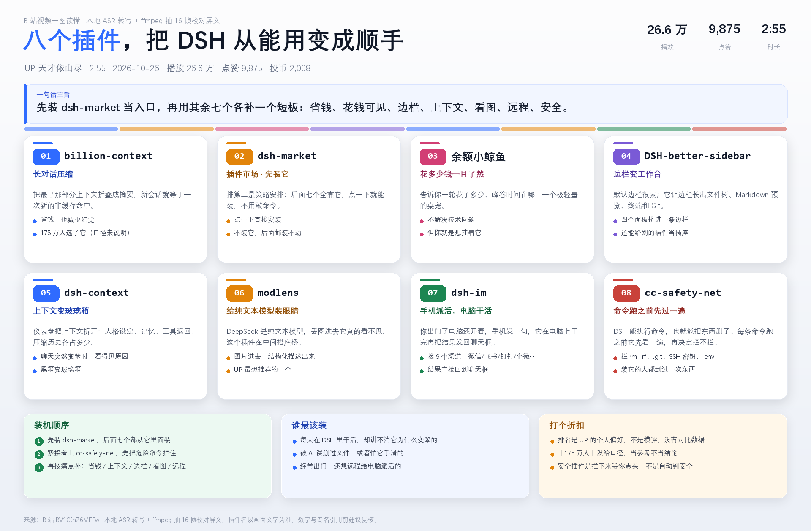

<p align="center">
  
</p>

<div align="center">

[](https://github.com/deepseek-ai/deepseek-harness)
[]()
[]()
[](https://ffmpeg.org/)
[]()
[](./LICENSE)

</div>

---

## 1. 它是什么

一个跑在 DSH 里的小插件：你在会话里丢一个 B 站视频链接，它把语音转成文字、从画面里抽几张帧做校对，模型读完写一份解析，最后画一张「一图读懂」。

用一句话说清楚它替你省了什么：

- 30 分钟的视频，先看一张图，感兴趣再翻解析里的原话。
- 只调 B 站公开 JSON 接口（`view` / `playurl`）。请求带 Chrome UA 和 `Referer: bilibili.com`，不碰 cookies。
- 官方字幕接口匿名请求返回 0 条，所以插件直接下音轨做本地 ASR。
- 整条链路不把音频传出去，缓存里只留一份原始 m4a，随时能删。
- 同一个视频第二次问直接读缓存，不再下载和转写。缓存里只有转录、没有帧时，插上 `frames` 参数再调一次，只补抽帧不重转。
- 1.1.0 起用上 ffmpeg，主要是抽帧对屏文，顺手做了音轨体检。

## 2. 效果预览

| 叙事版（观点 / 理财类） | 卡片版（榜单 / 清单类） |
|---|---|
|  |  |

示例视频：左图《原始积累的 5 条建议》（BV1HWJa61E9M，29 分 25 秒），右图《用 DSH 必须下载的八个插件》（BV1GJnZ6MEFw，2 分 55 秒）。

右图那张里的八个插件名，全部是按抽帧拍到的屏文校正过的——ASR 把 `modlens` 听成「Modulence」、`dsh-better-sidebar` 听成「Better CPI SIT A7」、`余额小鲸鱼` 听成「鱼鹅小鲫鱼」，只靠听是修不回来的。

解析过程的固定步骤：


## 3. 解析过程

1. **取元数据**：解析 BV 号，调 `/x/web-interface/view` 拿标题、UP 主、时长、播放、点赞、标签。数字当场从接口取。
2. **下音轨**：调 `/x/player/playurl?fnval=16` 取 DASH 音轨（m4a），优先挑码率最高的一路。失败自动换 backupUrl，不装 yt-dlp。
3. **音轨体检**：`ffprobe` 比一次时长。和接口时长差超过 3 秒 / 3% 就判成半截文件，自动重下一次，避免拿 30 秒音频跑 20 分钟转写。
4. **解码成 16kHz**：`ffmpeg -f f32le` 直接管道出 float32，不落盘；没装 ffmpeg 时回退 PyAV。
5. **本地转写**：喂 `faster-whisper-small`（int8，CPU）。默认 `beam_size=5`，`fast` 模式走 `beam_size=1`。输出 `txt` / `srt` / `tsv`，进度写 stderr，结果用一行 `RESULT_JSON:` 回传给 DSH。
6. **抽帧（可选）**：从 DASH 视频流里挑 ≤720p 那一路，用 `-ss` 按时间点抓帧（不整段下载视频），拼成 contact sheet。模型读图，把 ASR 听错的产品名、按钮文字对回来。
7. **写解析**：这一步在会话里由模型完成，不是插件算的。模型读转录 + 帧图，按「信息 / 结构 / 数字 / 评估」组织成 md。
8. **渲染出图**：把结构化内容交给 Pillow 画成「一图读懂」。md、转录和帧拼图一起写进输出目录。

一次性产出：

| 产物 | 说明 |
|---|---|
| `解析-视频标题.md` | 通读用的解析文档，含框架、屏文原话和评估 |
| `一图读懂-*.png` | 一页看完，叙事版 1920×1320，卡片版高度自适应 |
| `transcript.txt` / `.srt` / `.tsv` | 逐句转录，方便回查原话 |
| `sheet.png` | 抽帧拼图（`frames: 0` 时不产） |

耗时参考（CPU 推理，实测机器 12 线程）：

| 环节 | 优化前 | 现在 |
|---|---|---|
| 解码 175 秒音频 | PyAV 0.36s | ffmpeg 管道 0.18–0.25s |
| 转写（beam=5） | 73.4s | — |
| 转写（`fast`，beam=1） | — | 29.8–36.3s，文本相似度 0.988 |
| 3 分钟视频端到端 | 79.0s | 47.1s |
| 抽 16 帧拼图 | — | 7.5–21.6s（看 CDN） |

长视频按比例估：默认约视频时长 ×0.4，`fast` 约 ×0.25；30 分钟视频分别约 12 分钟 / 7.5 分钟。

## 4. 快速开始

### 4.1 前置条件

- **Windows 10 / 11**：一键装环境脚本是 PowerShell 写的；插件逻辑本身跨平台，但脚本目前只覆盖 Windows。
- **DSH 桌面版**：已实测 **0.2.1-rc.2**，需要支持 `ctx.tools` 工具注册的版本。
- **磁盘约 725MB**：模型 462MB + Python 依赖约 260MB，首次装环境要联网。
- **ffmpeg 可选但建议装**：装了才有抽帧校对、音轨体检、试转切片；没装时自动回退 PyAV 解码 + 跳过抽帧，其余功能照常。
- 不需要 B 站账号，不需要 yt-dlp。

### 4.2 安装插件

命令行走 profile 的插件管理器安装（DSH 桌面版一般用 `desktop`，dsh web 用 `web`）：

```bash
dsh plugin --profile desktop add github:zz12hui/dsh-bili-video-summary
```

> DSH 桌面版正在运行时，命令行不会改应用的 profile：先退出桌面版再执行，或等上架后在市场里一键安装。

装完**重启 DSH**（关闭窗口含托盘退出 → 重开 → 恢复会话）。首次使用还要装一次运行环境（模型 + Python 依赖，约 725MB），脚本位置见下面手动安装的第 3 条。

<details>
<summary>手动安装（旧版 / 离线环境）</summary>

```bash
git clone https://github.com/zz12hui/dsh-bili-video-summary.git
```

1. 把仓库内容复制到 `%USERPROFILE%\.dsh\profiles\desktop\node_modules\dsh-local-bili-summary\`。目录名要保持 `dsh-local-bili-summary`（和 `package.json` 的 `name` 一致），否则 profile 解析不到。
2. 在 `%USERPROFILE%\.dsh\profiles\desktop\cordis.patch.yml` 末尾追加：

   ```yaml
   - insert:
       - id: bili-summary-panel
         name: 'dsh-local-bili-summary'
   ```

3. 装运行环境（模型 + Python 依赖）：

   ```powershell
   powershell -ExecutionPolicy Bypass -File scripts\setup_env.ps1
   ```

   脚本会用阿里云镜像把 faster-whisper 装到独立的 `pylibs`，从 ModelScope 拉 `faster-whisper-small`，最后校验依赖。可传 `-Python` / `-DataHome` 换解释器和数据目录。用 `dsh plugin add` 装的，脚本在 `%USERPROFILE%\.dsh\profiles\desktop\node_modules\dsh-local-bili-summary\scripts\setup_env.ps1`。

4. **重启 DSH**（关闭窗口含托盘退出 → 重开 → 恢复会话）。插件在启动时注册工具，刷新页面不会加载它。

</details>

### 4.3 验证

发一个 B 站视频链接，助手应该先调 `bili_video_transcribe` 转写，再调 `bili_video_render` 出图。看得到两个工具名，就说明装好了。

## 5. 两个工具

| 工具 | 做什么 | 关键参数 |
|---|---|---|
| `bili_video_transcribe` | 下载音轨 + 本地转写 + 抽帧，返回元数据、全文、txt/srt/tsv 路径和帧拼图 | `url`（链接或 12 位 BV 号）、`frames`（默认 8，0 关闭）、`fast`（beam=1，约快 2.4 倍）、`force`（忽略缓存重转） |
| `bili_video_render` | 渲染一图读懂 PNG，并把 md 一起写进输出目录 | `payload`（内含 `md`、`plan`、`outDir`、`copyTranscripts` 等） |

正常调用顺序是固定的：`transcribe` → 读帧图校专名 → 模型写解析 → `render`。

`render` 的 `plan` 有两种版式，按视频结构选：

| 版式 | 触发 | 适用 |
|---|---|---|
| 叙事版 | 有 `pitfalls` / `milestones` / `suggestions` | 观点、理财、人生建议类 |
| 卡片版 | 有 `cards` | 「N 个 XX」榜单、插件、工具清单 |

卡片版的 `plan` 长这样：

```json
{
  "kicker": "B 站视频一图读懂 · 本地 ASR + ffmpeg 抽帧校对",
  "title": "八个插件，把 DSH 从能用变成顺手",
  "titleHl": "八个插件",
  "subtitle": "UP 主 · 时长 · 日期 · 播放 · 点赞",
  "stats": [{ "value": "26.6 万", "label": "播放" }],
  "quoteLabel": "一句话主旨",
  "quote": "先装 dsh-market 当入口，再用其余七个各补一个短板。",
  "cards": [
    { "num": "01", "en": "billion-context", "zh": "长对话压缩", "color": "blue",
      "desc": "把最早那部分上下文折叠成摘要。", "bullets": ["省钱，也减少幻觉"] }
  ],
  "panels": [
    { "title": "装机顺序", "color": "green", "ordered": true, "items": ["先装 dsh-market"] },
    { "title": "谁最该装", "color": "blue", "items": ["怕 AI 手滑删文件的"] },
    { "title": "打个折扣", "color": "amber", "items": ["排名是个人偏好，不是横评"] }
  ]
}
```

`cards` 是 4 列自动排布、卡片高度和整图高度都按内容自适应；`en` 里放中文（如「余额小鲸鱼」）会自动切中文字体，不会出豆腐块。

## 6. 配置与目录

可选环境变量：

| 变量 | 默认值 | 作用 |
|---|---|---|
| `BILI_SUMMARY_HOME` | `~/.dsh/bili-video-summary` | 数据根目录 |
| `BILI_SUMMARY_PYLIBS` | `$BILI_SUMMARY_HOME/pylibs` | Python 依赖目录 |
| `BILI_SUMMARY_MODEL` | `$BILI_SUMMARY_HOME/model/faster-whisper-small` | 模型目录 |
| `BILI_SUMMARY_PYTHON` | DSH 自带 Python 运行时 | Python 解释器 |
| `BILI_SUMMARY_FFMPEG` | 自动探测 | ffmpeg.exe 绝对路径 |
| `BILI_SUMMARY_FFPROBE` | 自动探测 | ffprobe.exe 绝对路径 |
| `BILI_SUMMARY_FFMPEG_DIR` | 自动探测 | 只给目录也行（下面要有 ffmpeg / ffprobe） |

ffmpeg 的探测顺序：环境变量 → `PATH` → `C:\ffmpeg\*\bin` 等常见目录。**注意**：DSH 里跑的子进程继承的是应用启动时的 `PATH`，刚写进用户 `PATH` 的目录它可能还看不到，所以插件不依赖 `PATH`，会自己按绝对路径找。

安装位置：

| 内容 | 路径 |
|---|---|
| 插件本体 | `%USERPROFILE%\.dsh\profiles\desktop\node_modules\dsh-local-bili-summary\` |
| profile 补丁行 | `%USERPROFILE%\.dsh\profiles\desktop\cordis.patch.yml` 末尾 `bili-summary-panel` |
| 数据根目录 | `%USERPROFILE%\.dsh\bili-video-summary\` |
| 缓存 | `…\cache\<BV号>\`（`audio.m4a` / `transcript.*` / `result.json` / `frames\`） |

仓库结构：

```text
dsh-bili-video-summary/
├── index.js                 # 注册两个工具，spawn Python 子进程，解析 RESULT_JSON
├── cordis.patch.yml         # DSH 启动时的插件注册行
├── scripts/
│   ├── bili_pipeline.py     # 元数据 → 音轨 → ffprobe 体检 → ffmpeg 解码 → 转写 → 抽帧
│   ├── render_summary.py    # plan → PNG（叙事版 / 卡片版）+ md
│   └── setup_env.ps1        # 一键装依赖和模型（约 725MB）
├── references/踩坑清单.md    # 首次手工解析的 16 条问题复盘
├── docs/                    # 示例图
├── assets/readme/           # README 首图与过程图
├── locale/                  # 插件清单里的中文名和描述
├── icon.svg
└── package.json
```

## 7. 为什么这样设计

第一次手工解析踩了 16 个坑，能固化的都写进插件了。几个关键取舍：

1. **不走网页抓取**：B 站页面是 JS 外壳，直接 fetch 拿不到内容；插件只用公开 JSON API。
2. **不等官方字幕**：匿名请求字幕接口返回 0 条，AI 总结接口要登录（`-101`），所以直接下音轨做本地 ASR。
3. **不装 yt-dlp**：`playurl` 直接给 DASH 音轨，少一个依赖少一个变量。
4. **ffmpeg 是可选增强，不是硬依赖**：音轨是 m4a，PyAV 本来就能解；装 ffmpeg 是为了抽帧、体检、切片。实测把解码从 PyAV 换到 ffmpeg 管道只省 0.18 秒——**ffmpeg 优化不了转写速度**，端到端 93% 的时间在 whisper 推理，所以真正提质量的是抽帧这条路。
5. **抽帧不整段下视频**：视频流动辄几十上百 MB，用 `-ss` 定位按时间点抓单帧，16 帧通常 10–20 秒内拿完；并发被 CDN 掐掉时会刷新 playurl 再串行重试。
6. **模型走 ModelScope**：hf-mirror 单线程只有约 300KB/s，多线程还会触发 429；ModelScope 实测约 9MB/s。
7. **绕开 av 19 的兼容问题**：faster-whisper 1.2.1 调 `av.open(metadata_errors=…)` 会报错，所以自己解成 float32 数组再喂模型。
8. **长任务交给插件**：Node `spawn` 管子进程，超时 60 分钟，一次调用跑完下载和转写，不被 shell 超时切碎。
9. **按 BV 号缓存**：同一视频第二次直接读缓存；`--clip` 试转的输出写到 `work\` 目录，不会覆盖缓存里的完整转录。

完整的 16 条问题清单（现象 → 根因 → 现在怎么做）见 [`references/踩坑清单.md`](./references/踩坑清单.md)。

## 8. 手动跑（排查用）

```powershell
$py = "$env:USERPROFILE\.dsh\dsh-runtimes\dsh-primary-runtime\dependencies\python\python.exe"
$pl = "$env:USERPROFILE\.dsh\profiles\desktop\node_modules\dsh-local-bili-summary\scripts"

# 转写：--force 忽略缓存；--clip 60 只转前 60 秒；--fast 走 beam=1；--frames 16 抽 16 帧
& $py "$pl\bili_pipeline.py" transcribe --url "https://www.bilibili.com/video/BVxxxx" --fast --frames 16

# 渲染
& $py "$pl\render_summary.py" --plan-file plan.json
```

脚本最后会打印一行 `RESULT_JSON:{...}`，排查时先看这一行和 stderr 里的进度。

## 9. 卸载与回滚

删掉 `cordis.patch.yml` 末尾的 `bili-summary-panel` 插入块和 `node_modules\dsh-local-bili-summary` 目录，重启 DSH 即可。数据目录 `~/.dsh/bili-video-summary` 可以留着（换插件版本还能用），想清干净就整个删掉。

## 10. 常见问题

**转写为什么这么慢？** CPU 推理，默认 `beam_size=5`，速度约视频时长的 0.4 倍。30 分钟视频约 12 分钟，第一次用之前最好先知道这个数。

**能不能快一点？** 调 `bili_video_transcribe({ fast: true })`，走 `beam_size=1`，实测快 2.4 倍（3 分钟视频 73s → 30s），中文文本相似度 0.988。要抠原话时再用默认值。

**没装 ffmpeg 会怎样？** 解码自动回退 PyAV，转写照常；只是没有帧拼图、音轨体检和快速切片。装了就自动用上，不用改配置。

**数字和专有名词不对？** small int8 对低频词和数字不敏感。带 `frames: 8` 再跑一次，把帧图交给模型对屏文，插件名、产品名这类能直接修回来；纯口播视频没有屏文可对，就只能在解析里标注「ASR 可能有误差」。

**报错找不到模型或依赖？** 重跑 `scripts\setup_env.ps1` 会补齐并校验。

**刷新页面后工具没出现？** host 插件只在 DSH 启动时加载，必须重启（含托盘退出），刷新浏览器不算。

**纯音乐视频能用吗？** 不能，没有语音会直接报「没有识别到任何语音内容」。

**macOS / Linux 能用吗？** 插件逻辑和 Python 脚本是跨平台的，但一键装环境脚本只写了 Windows，其他系统要手动装依赖。

## 11. License

[MIT](./LICENSE) © 2026 zz12hui

---

## 赞赏与联系

如果这个项目帮到你，欢迎请我喝杯咖啡。有问题也可以直接加微信。

| 微信支付 | 加我微信 |
| :---: | :---: |
|  |  |

- 发邮件可以发到 zz12hui@outlook.com 或 wws00123@qq.com。
- 加微信请直接扫码，备注一下来意。
